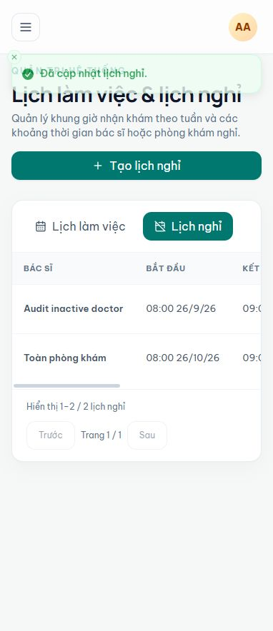
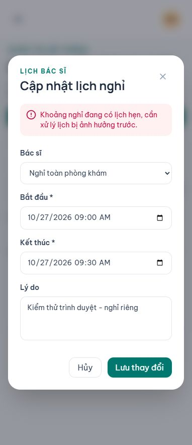
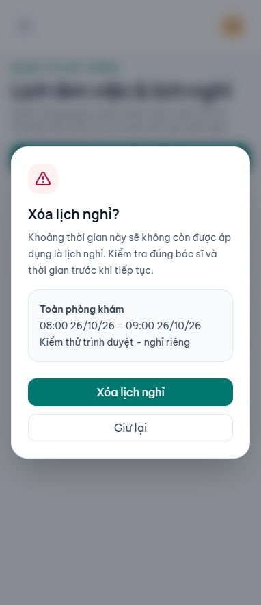

# Kiểm thử liên thông frontend và backend — Lịch làm việc & nghỉ

Ngày: 19/10/2026. Phạm vi là màn hình quản trị lịch làm việc/lịch nghỉ và tác động tới khung giờ đặt khám; không phải toàn bộ FoMed.

## Kết luận

Trong các tình huống đã kiểm tra, frontend và backend áp dụng đúng phạm vi bác sĩ/toàn phòng khám, giữ đúng giờ Việt Nam, từ chối xung đột và bảo vệ lịch hẹn. Chưa phát hiện thêm lỗi lưu sai phạm vi hoặc bỏ qua kiểm tra nghiệp vụ sau ba bản sửa backend. Có một điểm trải nghiệm nên cải thiện: thông báo sớm về bác sĩ ngừng hoạt động khi sửa lịch nghỉ cũ.

## Các lớp kiểm thử

| Lớp | Kết quả | Ý nghĩa |
| --- | --- | --- |
| React DOM + Sonner/Radix + adapter frontend thật → HTTP/JWT API thật → SQL Server tạm | 32 ca đạt | Không giả lập phản hồi API hoặc dịch vụ nghiệp vụ |
| Kiểm tra phía máy chủ sau thao tác frontend | 4 kiểm tra đạt | Tiến trình UI kết thúc thành công; lịch hẹn không bị chuyển/hủy/nhân đôi; không lưu mã bác sĩ lỗi; có nhật ký xóa |
| Hồi quy React DOM/Radix với API giả lập | 75 ca đạt | Focus, bàn phím, chống nhấn lặp, lỗi tải lại, phân trang, xác nhận xóa và kiểm tra dữ liệu form |
| Trình duyệt IAB thật + Vite proxy → API local thật | Đã kiểm tra trực tiếp | Đăng nhập, tạo nghỉ riêng, sửa thành toàn phòng khám, trùng lịch hẹn, lỗi bác sĩ ngừng hoạt động, hủy xóa và tải lại |
| Frontend lint | Đạt | Không có lỗi lint |

Không cộng các lớp này thành tỷ lệ bao phủ toàn hệ thống. Bộ backend 45 + 57 ca đã đạt ở đợt sửa trước; kết quả và phạm vi riêng nằm trong [báo cáo backend](admin-schedule-backend-assessment.md).

## Kịch bản đã xác nhận

1. Đăng nhập tài khoản giả qua API thật; token đi qua xác thực/phân quyền của API. Adapter xử lý được cả phản hồi danh sách bác sĩ có lớp bao và danh sách lịch nghỉ trả trực tiếp.
2. Form thêm lịch nghỉ không cho chọn bác sĩ ngừng hoạt động; dữ liệu thiếu bị chặn trước khi gửi HTTP.
3. Nhập 08:00–09:00, gửi giờ ISO từ frontend, chuẩn hóa tại backend, đọc lại/mở sửa vẫn là 08:00–09:00, không lệch 7 giờ.
4. Nghỉ riêng chỉ chặn hai khung 08:00 và 08:30 của bác sĩ được chọn; bác sĩ còn lại vẫn nhận khám. Các kiểm tra xác nhận có đủ hai khung thực tế, không kiểm tra trên mảng rỗng.
5. Chuyển sang toàn phòng khám: frontend bỏ trường `doctorId`, backend lưu `null`, danh sách đổi đúng nhãn và cả hai bác sĩ đều bị chặn ở khoảng nghỉ.
6. Chuyển ngược về một bác sĩ: khung giờ của bác sĩ khác được mở lại.
7. Khi khoảng nghỉ toàn phòng khám trùng lịch hẹn của bác sĩ khác, API trả 409; form giữ nội dung đang nhập và hiển thị thông báo có dấu. Dữ liệu cũ không đổi, kể cả sau khi hủy và tải lại trình duyệt.
8. Mã bác sĩ không tồn tại, 0, âm hoặc ngừng hoạt động bị adapter nhận là lỗi 404 rõ ràng, không lộ thông tin SQL.
9. Xóa mở hộp xác nhận Radix/Tailwind ghi đúng bác sĩ/phạm vi, ngày giờ và lý do. Hủy không gửi lệnh xóa. Kiểm thử tự động xác nhận HTTP 204 chỉ xóa đúng bản ghi, tải lại danh sách, ghi nhật ký và mở lại khung giờ. Trên trình duyệt thật chỉ mở hộp xác nhận và chọn Giữ lại, không xác nhận xóa.
10. Tạo lịch làm việc bảy ngày từ một lần gửi form tạo đủ bảy bản ghi có phiên bản, các giờ mới có thể đặt khám. Thêm trùng bị từ chối, không sinh thêm ngày.
11. Khi một phiên khác đã sửa lịch làm việc, phiên bản cũ trên form bị trả 409, không ghi đè dữ liệu mới.
12. Ngừng ca có lịch hẹn bị từ chối và giữ hộp xác nhận; lịch hẹn không tự chuyển hoặc hủy.
13. Token của bác sĩ/lễ tân/bệnh nhân không ghi được qua endpoint quản trị lịch nghỉ (403). Lễ tân có luồng quản lý lịch làm việc riêng; kiểm tra này không có nghĩa chặn luồng riêng đó.

## Điểm còn nên cải thiện

### Cảnh báo sớm khi sửa lịch nghỉ của bác sĩ ngừng hoạt động

Form giữ bác sĩ cũ để người dùng thấy đúng dữ liệu lịch sử, nhưng lựa chọn hiện tại chưa có hậu tố “ngừng hoạt động” hoặc hướng dẫn đổi phạm vi. Nhấn Lưu với bác sĩ này được backend từ chối đúng bằng thông báo “Không tìm thấy bác sĩ đang hoạt động.”

Đây là thiếu hướng dẫn trên giao diện, không phải backend chấp nhận dữ liệu sai. Nên gắn nhãn bác sĩ ngừng hoạt động và báo trước rằng cần chọn bác sĩ đang hoạt động hoặc nghỉ toàn phòng khám. Chưa sửa vì yêu cầu của đợt này là kiểm thử/đánh giá.

## Minh chứng trình duyệt







## Chạy lại

Từ thư mục backend gốc, với SQL Server localhost và quyền Windows tạo/xóa database kiểm thử:

```powershell
dotnet publish FoMed-API/FoMed.Api/FoMed.Api.csproj -c Release -o FoMed-API/FoMed.Api/bin/WorkflowAuditPublish
dotnet run --project tests/ClinicWorkflow/ClinicWorkflow.csproj -c Release -- --http --schedules-only
```

Để giữ API/Vite local cho kiểm tra trình duyệt, thêm `--browser`. Bộ kiểm thử sử dụng cổng API 5181 và Vite 5194, từ chối cổng đang bị chiếm. Cờ dừng có đường dẫn ngẫu nhiên được in ra; tạo cờ đó để kết thúc. Môi trường tự kết thúc sau tối đa 15 phút. Các cổng/đường dẫn này chỉ phục vụ kiểm thử, không phải cấu hình triển khai FoMed.

Hồi quy frontend với API giả lập, từ thư mục `FoMed-Frontend`:

```powershell
node tests/admin-schedules.audit.cjs
npm run lint
```

## Giới hạn và an toàn

- Chỉ dùng dữ liệu giả, database localhost tên ngẫu nhiên có kiểm tra an toàn. Không đọc cấu hình Development riêng tư, không sử dụng tài khoản Azure/Render/Vercel thật, không thanh toán hoặc gửi thông báo bên ngoài.
- Các lần kiểm thử đã dọn database và tiến trình API/Vite riêng; không dừng các máy chủ phát triển có sẵn của người dùng.
- Trình duyệt kiểm tra ở khung hiển thị hẹp; chưa đánh giá toàn bộ breakpoint desktop hoặc mọi trình duyệt/múi giờ.
- Browser đi qua Vite proxy local. Đây không phải xác nhận cấu hình CORS/HTTPS hoặc phiên bản đang triển khai trên Vercel/Render.
- Bộ chạy React DOM đôi lúc phát cảnh báo `act(...)` do bộ đếm giờ Sonner chạy trong lúc chờ HTTP; không có ca nghiệp vụ thất bại từ cảnh báo này. Không tắt giới hạn đăng nhập API để chạy kiểm thử; đã bỏ các lần đăng nhập fixture không liên quan nhằm tránh tự chạm giới hạn.
- Không sửa logic sản phẩm trong đợt này; chỉ bổ sung bộ kiểm thử, báo cáo và ảnh minh chứng. Chưa commit/push/deploy.
